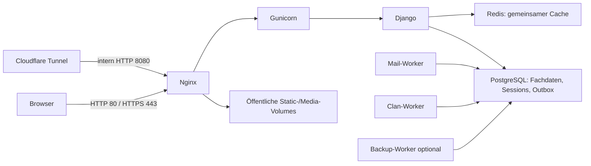

# EntailsNG – Entwicklerübergabe

Stand: 23. Oktober 2026. Maßgeblich sind Code und Konfiguration. Sicherheitsupdate B1: [Änderungen und neue Prüfnachweise](docs/b1-django-security-update-results.md). Weiterer Umsetzungsstand, Testbefehle und Grenzen: [Nachweise zu P1–P6](docs/remediation-progress.md). Die Bereinigung nach dem Repository-Audit (`AUDIT_BERICHT.md`, Punkte 2–7 und 11) ist umgesetzt; der Bericht selbst wurde mit `fabe8f3` entfernt und ist über `git show 8b714bb:AUDIT_BERICHT.md` abrufbar. Dabei wurden die vorherige Übergabe samt historischen Prüfberichten (`docs/verification-history.md`), der Audit des Stands vor P1–P6, die Turniermodus-Reviews vom 1. Oktober und die datierten Release-Nachweise (`docs/verification/`) aus dem Repository entfernt; bis Commit `85ba422` sind sie dort erhalten, z. B. `git show 85ba422:docs/verification-history.md`.

## Zweck und Architektur

EntailsNG verwaltet LAN-Veranstaltungen, Gäste, Tickets, Zahlungen, Sitzplätze, Check-in und Turniere. 50 bis 1.000+ registrierte Gäste sind eine Zielgröße; daraus folgt keine Zusage über gleichzeitige Zugriffe. Die Anwendung ist auf Deutsch eingestellt; `SystemTranslation` verwaltet einen anpassbaren Text je Schlüssel, keine Sprachvarianten. Neun Themes und globale UI-Skalierung sind implementiert.



Der Monolith verwendet PostgreSQL-Zeilensperren/Constraints für konkurrierende Buchungen und Änderungen. Die DB-Outbox bindet Mailaufträge an fachliche Transaktionen; SMTP-Zustellung und DB-Bestätigung bleiben getrennte Vorgänge. Redis stellt den gemeinsamen Cache für Webworker bereit. Gunicorn startet im Image standardmäßig drei Worker (`WEB_CONCURRENCY`); der Entwicklungsserver verwendet diese Einstellung nicht. WhiteNoise liegt im Django-Middlewarepfad; Nginx liefert Assets direkt aus.

Private Wiki-Anhänge liegen getrennt von öffentlichen Medien und werden nur durch autorisierte Views ausgeliefert. Der Backup-Worker erhält ebenfalls das private Volume; Nginx und Mail-Worker nicht. Dateisperren koordinieren Backups nur auf einem Host, nicht über NFS/verteilte Hosts. Der separate Tunnel-Eingang schützt die Vertrauensgrenze gegenüber öffentlichen Proxyheadern.

Die Kernassets, Fonts, TinyMCE und QR-Erzeugung sind lokal. Optional eingebettete Anbieter, externe News-Bilder, SMTP und ein Cloudflare-Tunnel brauchen jeweils ihre Gegenstelle. Für Offlinebetrieb Pakete, Images und Inhalte vorab bereitstellen.

## Tech-Stack

| Bereich | Maßgeblicher Stand |
| --- | --- |
| Python/Django | Image und CI: Python 3.12; Django 6.0.9. Lokal zusätzlich Python 3.14.8 geprüft; keine allgemeine Python-Versionsmatrix. NetworkX 3.6.1 schließt 3.14.1 aus. Python 3.15 ist mit den aktuellen Pins nicht installierbar (kein Wheel für psycopg-binary 3.2.13). |
| Pythonpakete | Direkte Abhängigkeiten in [requirements.in](requirements.in) (Django, django-tinymce, psycopg[binary], Pillow, redis, Gunicorn, WhiteNoise, python-dotenv, cryptography, qrcode, NetworkX); daraus erzeugt pip-compile 7.5.2 mit Python 3.12 das Lockfile [requirements.txt](requirements.txt) mit allen transitiven Paketen und Hashes. pip installiert daraus automatisch im Hash-Prüfmodus. Änderungen nur in `requirements.in`, danach neu kompilieren (Befehl im Dateikopf). |
| DB/Cache | Compose/CI: PostgreSQL 16 und Redis 7. PostgreSQL ist verbindlich; native Backup-Tools müssen dieselbe Hauptversion wie der Server haben. |
| Web | Python 3.12.16-slim-bookworm, Nginx 1.30.6 (Stable-Zweig), PostgreSQL 16.15 und Redis 7.4.12 (jeweils Alpine) sowie Certbot 5.8.0 und cloudflared 2026.10.0 sind mit Tag und Digest festgelegt (Stand 29.10.2026, Compose, Dockerfile und CI-Dienste); Updates bewusst durch Anpassen von Tag und Digest. Definitionen: [Dockerfile](Dockerfile), [Compose](docker-compose.yml). |
| Frontend | Vanilla-JavaScript und CSS-Variablen; lokale Fonts Barlow Condensed, DM Sans, JetBrains Mono. Node nur für Tests (CI: 22). |

## Lokales Setup auf einer frischen Entwicklungsdatenbank

Benötigt werden Python 3.12 mit venv/pip, Docker Compose oder native PostgreSQL-/Redis-Dienste und optional Node 22. Repository-URL aus der eigenen Projektablage verwenden.

```bash
git clone <repo-url> entails-ng
cd entails-ng
python3.12 -m venv .venv
source .venv/bin/activate
python -m pip install -r requirements.txt
cp .env.example .env
```

In der neuen `.env` SECRET_KEY, FIELD_ENCRYPTION_KEY und REDIS_PASSWORD jeweils separat generieren, etwa mit `python -c "import secrets; print(secrets.token_urlsafe(50))"`; ein eigenes DB-Passwort setzen. Für einen auf dem Host gestarteten Webprozess außerdem:

```dotenv
DEBUG=True
ALLOWED_HOSTS=localhost,127.0.0.1,testserver
CSRF_TRUSTED_ORIGINS=http://localhost:8000,http://127.0.0.1:8000
DB_HOST=127.0.0.1
DB_PORT=5432
REDIS_URL=redis://:<REDIS_PASSWORD>@127.0.0.1:6379/1
BEHIND_PROXY=False
PUBLIC_BASE_URL=http://127.0.0.1:8000
EMAIL_BACKEND=django.core.mail.backends.console.EmailBackend
DEMO_MODE=False
```

DB_NAME/DB_USER/DB_PASSWORD aus derselben `.env` initialisieren eine frische Compose-Datenbank. Ein vorhandenes `postgres_data`-Volume übernimmt geänderte Zugangsdaten nicht allein durch eine neue `.env`.

```bash
docker compose up -d --wait db redis
python scripts/wait_for_postgres.py --timeout 30
python manage.py migrate
python manage.py seed_translations
python manage.py seed_features
python manage.py seed_email_templates
python manage.py createsuperuser
python manage.py runserver
```

Admin: `http://127.0.0.1:8000/admin/`. Keine Standardkonten oder Standardpasswörter. Alternativ initialisiert `./install.sh` eine lokale Umgebung und ergänzt nur bei fehlender `.env` lokale Vorgaben samt Zufallsschlüsseln; vorhandene Konfiguration bleibt erhalten. `./start.sh` gleicht die venv mit den Pins in `requirements.txt` ab (`scripts/check_requirements.py`, installiert bei Abweichung nach und bricht ab, wenn das nicht gelingt) und startet den Entwicklungsserver auf 127.0.0.1:8000; Zugriff aus dem LAN nur ausdrücklich mit `RUNSERVER_ADDR=0.0.0.0:8000 ./start.sh` (Warnung bei `DEBUG=True`). Für dauerhaften Veranstaltungsbetrieb Gunicorn/Nginx verwenden.

Die drei System-Seeds ergänzen fehlende Werte; vorhandene Texte/Vorlagen bleiben bestehen. `seed_features` ergänzt auch fehlende Standardicons und normalisiert alte Menünamen; `--reset` setzt Menükonfiguration ausdrücklich zurück. Automatisches `post_migrate`-Seeding ist vorhanden, ersetzt aber die expliziten, auf Fehler geprüften Startkommandos nicht.

### Optionale synthetische Demodaten

```bash
DEMO_MODE=True python manage.py seed_demo_data
```

Der Generator benötigt Migration `configuration.0025_demodataset`. Er akzeptiert nur eine frische Datenbank ohne Fachdaten; System-Seeds und selbst angelegte aktive Superuser sind erlaubt. Er erstellt einen inaktiven Evententwurf mit zukünftigen Terminen, kostenlosem Ticket, vier synthetischen Gästen/Beispielbuchungen, acht Sitzen, Clan, zwei Teams und Turnierentwurf. Bootstrap-Beispielbuchungen sind bereits im inaktiven Entwurf hinterlegt. Er versendet keine E-Mails und ändert die Mailkonfiguration nicht.

Gäste haben **kein nutzbares Passwort**. Für einen Gastlogin individuell `python manage.py changepassword demo_guest_1` verwenden. Einen Administrator separat anlegen. Ein versionierter Abschlussnachweis und eine PostgreSQL-Sperre sichern atomare, parallele und wiederholte Aufrufe; bei unverändert vollständiger Demo bleibt der Datenbestand unverändert. Bei fehlenden Objekten, veränderten Beziehungen oder anderer Version erfolgt ein Abbruch, kein Reset.

`./install.sh --demo`, `scripts/setup_postgres.py --demo` und ausdrücklich aktivierter Docker-DEMO_MODE verwenden denselben Service. Die Adminaktion „Demo-Daten einrichten“ benötigt eine entsprechend aktivierte Demo-Umgebung. Wenn die Demo anschließend frei bearbeitet wird, DEMO_MODE nach der initialen Einrichtung wieder deaktivieren: Ein aktiver Generator bricht bei veränderten Beziehungen ausdrücklich ab. Der frühere Alias `reset_demo_data` und der Snapshot `initial_data.json` wurden am 23.10.2026 entfernt; Demodaten entstehen ausschließlich über `seed_demo_data`.

### Erste Veranstaltung und Hintergrundprozesse

Unter „Allgemeine E-Mail Einstellungen“ Versandweg und Absender setzen; frisch ist der Versand „Noch nicht eingerichtet“. Das lokale Console-Backend gibt Entwicklungsmails aus. Produktion verwendet `emails.backends.ConfiguredSMTPBackend` mit gültigen SMTP-Daten, Aktivierung und ggf. Sandbox im Admin. Ein Resend-API-Backend ist nicht implementiert.

Event im Entwurf mit künftigen Terminen, Ort, Kapazität und aktiven Tickets anlegen. Für kostenpflichtige Tickets Bankdaten ergänzen. Die Adminaktion „Bereitschaft prüfen und Anmeldung öffnen“ prüft diese Voraussetzungen erneut und öffnet atomar. Abschluss ist erst nach Beendigung/Absage aller internen Turniere möglich; er deaktiviert das Event und archiviert Teams.

`runserver` startet keine dauerhaften Worker; Mails verschickt nur der Mail-Worker, außer `EMAIL_INLINE_TRIGGER=True` (lokale Vorgabe von `install.sh`). In Compose melden Mail-, Clan- und Gastfoto-Worker erfolgreiche Durchläufe über `WORKER_HEARTBEAT_FILE`; ihr Healthcheck wird „unhealthy“, wenn der Heartbeat ausbleibt (2, 5 bzw. 125 Minuten). Der Backup-Worker hat wegen langer Sicherungs-/Restorejobs keinen. In separaten Terminals mit derselben venv:

```bash
python manage.py process_email_queue --daemon --interval 5
python manage.py process_clan_seat_holds --daemon --interval 60   # auch Ticket-Zahlungsfristen (einmalig: process_payment_deadlines)
python manage.py purge_guest_photos --daemon --interval 3600   # auch Fehlerprotokoll-Frist und abgelaufene Sessions
# Optional nach Einrichtung von Schlüssel, Speicher und passenden PG-Tools:
python manage.py process_backup_jobs --daemon
```

Die vollständige [Env-Matrix](docs/configuration.md) beschreibt Defaults und Bedingungen. `.env.example` verwendet Produktionsvorgaben; Prozessvariablen haben Vorrang vor `.env`. Schlüssel nie ins Repository aufnehmen und getrennt sichern.

## Apps und Verantwortlichkeiten

| App/Paket | Verantwortung und Einstieg |
| --- | --- |
| `config` | Projektsettings, Root-URLs, WSGI/ASGI, Testrunner (`config/testing.py`); keine eigene registrierte Fachapp. |
| `events` | Event, **TicketType**, EventRegistration, Zahlungs-/Anmelde-/Check-in-Services; `/checkin/scanner/`; [Scanner](docs/scanner-feedback.md), [erweiterter Check-in mit Gastfoto](docs/extended-checkin.md), [Anmeldebestätigung und Zahlungsfrist](docs/registration-confirmation.md). |
| `users` | E-Mail-/Username-Login über EmailOrUsernameBackend, Verifizierung, Profil, Kontolöschung, Orga-Sperren; [Löschung](docs/account-deletion.md), [Sperren](docs/user-bans.md). |
| `tournaments` | Sechs Modi, Teams/Kader/Einladungen, Vorschau/Start, Ergebnisse/Bestätigung, Neustarts und externe Turniere. Services im **Paket** `tournaments/services/`; [Auslosung](docs/tournament-draws.md), [Ergebnisse](docs/tournament-result-management.md), [Einladungen](docs/team-recruitment.md), [externe Turniere](docs/external-tournaments.md). Podium erst nach expliziter Bestätigung und FINISHED. |
| `seating` | Rastereditor, Reservierungen, Clanvormerkungen und Sammelzahlungen; [Vormerkungen](docs/clan-seat-holds.md), [Zahlungen](docs/clan-seat-payments.md). |
| `clans` | Mitgliedschaften, mehrere gleichberechtigte Admins, Schutz des letzten aktiven Admins; [Clan-Admins](docs/clan-admins.md). |
| `configuration` | Navigation, Systemtexte, Themes, Cache, Fehlerprotokoll, globale Konfiguration; Demo-Service und Laufzeitcheck. |
| `contact` | Öffentliches Kontaktformular `/kontakt/`, Kategorien/Empfänger, signierte Idempotenz und DB-Limits; [Kontakt](docs/contact-form.md). |
| `info` | CMS-Seiten und freigegebene Einbettungen; [Einbettungen](docs/external-embedding.md). |
| `knowledge` | Mitarbeiterwissen mit Revisionen, Veröffentlichung, Konfliktprüfung und privaten Anhängen; [Wissensbasis](docs/internal-knowledge-base.md). |
| `news` | Veröffentlichte Artikel, angepinnte Meldung und Dashboardkarussell; [Karussell](docs/news-carousel.md). |
| `emails` | Dynamisch konfiguriertes SMTP-Backend, verschlüsselte Zugangsdaten, persistente Outbox/Leases, eingebettetes QR-Bild (`inline_qr_payload` → `cid:payment_qr`), Adminbereinigung; [Bereinigung](docs/email-cleanup.md). |
| `media_designer` | Eventgebundene Badge-/Urkundenvorlagen, verwaltete Fonts, lokale 300-DPI-PDFs; Einstieg `/media-designer/` für Mitarbeiter. |
| `sponsors` | Partner, Sponsoren, Logos und öffentliche Übersicht. |
| `backups` | Verschlüsselte native PG-/Mediensicherungen, isolierte Vorprüfung, Wartungsfenster und Recovery; [Betriebsanleitung](docs/backups.md). |

## Tests, CI und Betriebsprüfung

Eine ausdrücklich dafür vorgesehene PostgreSQL-Verbindung verwenden. Die Rolle braucht CREATEDB und für native Backup-/Restoretests Eigentümerrechte sowie passende PG-Programme. Django-Tests verwenden LocMemCache; reale Redisprüfungen laufen separat. Der Testrunner `config.testing.IsolatedMediaTestRunner` leitet `MEDIA_ROOT` und `PRIVATE_MEDIA_ROOT` für den ganzen Lauf in ein temporäres Verzeichnis um, sodass Tests keine Dateien in `media/` oder `private_media/` hinterlassen. Bei `--parallel` gilt das nur für per fork gestartete Worker (Linux, CI, Container), nicht unter Windows/macOS.

```bash
python manage.py check
python manage.py makemigrations --check --dry-run
python manage.py test --noinput
node --test scripts/tests/*.test.cjs
ruff check .   # ruff==0.17.3 in separater Tool-Umgebung
python manage.py check_runtime --health-host 127.0.0.1 --require-redis
```

Die [CI](.github/workflows/ci.yml) läuft für main/master mit Python 3.12, PostgreSQL 16, Redis 7 und Node 22. Sie prüft Django/JavaScript/Migrationen, ein frisches Setup samt Demo-Wiederholung, echten prozessübergreifenden Redis sowie einen isolierten Imagebau/Compose-Start. Dieser prüft auch HTTPS, statische Dateien, alle Worker und HTTP-Lastszenarien. Keine pauschale WCAG-Aussage aus diesen Tests ableiten. Die CI prüft zusätzlich mit ruff 0.17.3 (Regeln F und E9, Konfiguration [ruff.toml](ruff.toml); lokal `ruff check .`), läuft mit `permissions: contents: read` und bindet Actions per Commit-SHA. Ein Formatter ist nicht konfiguriert.

Seit B1 exportieren `scripts/dependency_inventory.py` und der Container-Smoke den vollständigen installierten Paketbestand einschließlich pip. Ein separater pip-audit-2.10.1-Prozess prüft die Inventare der Testumgebung und des Images; Befunde, übersprungene Pakete, unvollständige Ergebnisse und Abruffehler verhindern einen erfolgreichen Prüfschritt. Zusätzlich wird Django gegen den exakten Pin und mindestens 6.0.9 geprüft. Image/CI verwenden pip 26.2.1; python-dotenv ist auf 1.2.4 aktualisiert. Pillow ist seit 23.10.2026 auf 13.0.0 angehoben, weil pip-audit für 12.3.0 35 Sicherheitsbefunde meldete. Ein lokaler Auditlauf braucht ebenfalls pip 26.2.1, sonst meldet er Befunde zu älteren pip-Versionen. Offizielle Django-Sicherheitshinweise bleiben zusätzlich maßgeblich, da ein Scanner nicht alle aktuellen Korrekturen erfassen muss.

## Deployment und Betrieb

Schrittfolge, Wartungsfenster, Migrationen, Rollbackgrenzen, TLS-Erneuerung und Prüfkommandos stehen in [Updates und Betrieb](docs/updating.md); Ersteinrichtung zusätzlich in [INSTRUCTIONS.MD](INSTRUCTIONS.MD).

Tunnel-Origin: **HTTP `nginx:8080`**. Öffentliche Ports 80/443 übernehmen keine eingesandten Client-IP-/Protokollangaben als vertrauenswürdig. `ALLOWED_HOSTS` braucht neben der Domain den Loopbackhost für den Compose-Healthcheck. Die Route `/api/health/` prüft DB/Cache, nicht den externen Tunnel oder die Zertifikatserneuerung.

Der Entrypoint führt normalerweise Migrationen, statische Dateien und Seeds aus; erforderliche Seedfehler brechen den Start ab. Umgebungs-/Mountänderungen benötigen neu erstellte Container. Das Image enthält laut `.dockerignore` weder `docs/` noch `scripts/tests/` noch Python-Caches. Persistente Volumes und getrennte Schlüssel erhalten. Migration 0017 rotiert Teamcodes beim erstmaligen Anwenden irreversibel. Nach Restore werden Sessions/Codes entfernt und Mail pausiert; Wiederfreigabe erst nach Betriebsprüfung.

## Konventionen, Entscheidungen und offene Punkte

- Aktives Event über `Event.objects.get_active()`, Cachezugriffe/-invalidierung über `configuration.cache`. Fachliche Statusänderungen in den vorhandenen Services ausführen; `seating/services.py` und `users/services.py` existieren bereits. Weitere Auslagerung aus Models/Views bleibt schrittweise Arbeit.
- Benutzertexte über `get_translation` bzw. das eingebaute ``-Tag; Standards in DEFAULT_TEXTS ergänzen und seeden. Platzhalter in Texten sind nur einfache benannte Felder wie `{team_name}`; Werte werden vorher in Strings umgewandelt, Attribut-, Index-, Positions- und Formatangaben (`{x.attr}`, `{x[0]}`, `{0}`, `{x:>5}`) werden nicht aufgelöst, der Text erscheint dann unformatiert. Deshalb nur Strings oder Zahlen übergeben, keine Model-Objekte. Für Frontendaktionen Inline-Bestätigungen und die gemeinsamen [Linkkonventionen](docs/link-styling.md) verwenden.
- **Sitzplatzwahl schließt ab Eventstart:** Zentrale Regel `Event.is_seat_selection_open` (effektiver Status = Anmeldung geöffnet). Gilt für Gast-Reservierung/-Freigabe, Clan-Vormerkungen (unbezahlte Holds verlieren ab Start den Schutz und laufen über `process_clan_holds` ab) und Clan-Zuweisungen (während des Events nur Orga mit Begründung). Admin-Zuweisung/-Freigabe/-Sperre bleiben erlaubt.
- **Echter Name ist Pflicht:** Vor-/Nachname (`first_name`/`last_name` aus `AbstractUser`) werden bei der Registrierung erfasst und über `users.forms.validate_real_name` geprüft. Bestandskonten ohne Namen können sich nicht zu Events anmelden (Ausnahme: bezahlte Clan-Plätze) und sehen einen Dashboard-Hinweis. Nach bezahlter/eingecheckter Anmeldung zum aktiven Event ändert nur noch die Orga den Namen (`User.is_real_name_locked`). Orga-Konten (`is_staff`/`is_superuser`, siehe `User.requires_real_name`) sind ausgenommen: keine Namenspflicht bei Anmeldung und Profil, keine Namenssperre, kein Hinweis; unveränderte Altwerte werden nicht nachträglich validiert, damit Updates keine Admin-/Mitarbeiterkonten blockieren. Der Klarname ist nur für Gast und Orga sichtbar; Verwendungszweck einheitlich über `EventRegistration.payment_reference` (Kurzcode + Name). Die Datenschutzerklärung liegt pro Installation in der DB und muss bei bestehenden Installationen manuell ergänzt werden.
- **Gästeliste (`/guests/`) ist öffentlich**, aber nur für veröffentlichte Events (effektiver Status „Anmeldung geöffnet“ oder „läuft“); Entwürfe, beendete und abgesagte Events sehen nur Staff-Konten. Benutzername, Clan und Sitzplatz sind sichtbar; den Zahlungsstatus (Spalte, Statistik, Filter) sehen nur Staff bzw. Konten mit `events.can_update_payment_check`, Gäste nur für die eigene Anmeldung. Die Datenschutzerklärung der Installation muss diese Veröffentlichung abdecken.
- **USERS-03 bleibt bewusst zurückgestellt.** Benutzerverwaltungsrechte und privater Bericht: [Sicherheitsbacklog](docs/security-backlog.md). Keine Rechteänderung durch die aktuelle Umsetzung.
- SMTP-Annahme und DB-Bestätigung sind nicht atomar; bei Prozessabbruch kann Zustellung unsicher sein und eine Wiederholung auftreten. Keine Exactly-once-Zustellung zugesichert.
- Tatsächliche Produktionsmigrationen, Gruppenrechte, Cloudflare-/ACME-/SMTP-Betrieb, manuelle Screenreader-Abnahme und menschlicher Ersteinstieg benötigen separate Nachweise. Keine Produktion durch Testskripte konfigurieren.
- [Entwicklungsbacklog](docs/development-backlog.md) trennt offene Nachweise von Produktideen. Die Scanner-Prozentanzeige ist vorhanden; Dashboardwidget und Stoßzeitenauswertung wären zusätzliche Funktionen. [Qualitätsprüfplan](docs/quality-verification.md) definiert Messungen und Aussagegrenzen; Produktprioritäten und konkrete Verantwortliche sind teilweise noch offen.
